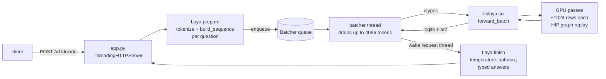

# Architecture

layamd serves [Laya](https://huggingface.co/convaiinnovations/laya) decisions over HTTP from a
custom HIP engine written for one GPU: the Radeon 8060S in AMD Strix Halo (gfx1151, RDNA 3.5,
40 CUs, up to 128 GB of unified LPDDR5X). This page explains what runs where. The reasons
behind the performance choices are in [optimizations.md](optimizations.md); how correctness
is checked is in [correctness.md](correctness.md).

## The request path



1. **HTTP** (`server/app.py`). A `ThreadingHTTPServer` gives each connection its own thread.
   Responses are written in one `send` with `TCP_NODELAY`; see
   [optimizations.md](optimizations.md#server) for why that matters.
2. **Preparation** (`server/laya_server.py`, request thread). Each question becomes one token
   sequence. Tokenization uses the Rust `tokenizers` library and takes about 100 µs. The
   sequence layout is ported from upstream's `rl_common.build_sequence` (below).
3. **Continuous batching** (`Batcher`, one thread). The batcher takes the first waiting
   request, then everything else already queued up to `LAYA_BATCH_TOKENS` (4096), and makes
   one engine call. A lone request goes straight through with no added wait. Under load, the
   requests that arrive during one GPU round form the next round.
4. **Engine** (`src/`, called through the C API in `laya_api.h`). The engine packs the
   questions, splits them into GPU passes, and returns per-option logits plus act-head
   logits.
5. **Answers** (`Laya.finish`). The server divides logits by the calibrated temperature for
   the question type and option count, applies a softmax, and builds the typed answer: a
   `choice` with probabilities, a `score` as the expected level, or a yes/no (`noul`)
   probability. The shape is the same as upstream `RLAgent.system_one`.

## The model

Laya is an encoder with a small decision head. It reads the state and the question in one
forward pass and scores every option at its own `[MASK]` marker, so no text is generated.

| | English / typed-decisions | multilingual |
|---|---|---|
| Encoder | ModernBERT-large: 28 layers, d=1024, 16 heads, GeGLU 2624 | mmBERT-base: 22 layers, d=768, 12 heads, GeGLU 1152 |
| Vocabulary | 50,368 | 256,000 |
| Attention | every 3rd layer global, others sliding window of 128 | same |
| Positions | RoPE, θ 160k global / 10k local | same |
| Context (`max_len` / `head_max_len`) | 512 / 192 (typed: 1024 / 256) | 1024 / 256 |
| Parameters | 421M | 322M |

After the encoder's final LayerNorm, a learned **type embedding** for the question type
(choice, score or noul) is added to every row of that sequence. The **decision head** is two
pre-norm transformer layers (full attention, ReLU FFN of 4d, with biases). Two heads read its
output:

- **Scorer**, at each option marker: LayerNorm, Linear(d→d), GELU, Linear(d→1). This gives
  one logit per option, softmaxed over the question's options.
- **Act head**, at CLS: the CLS vector plus four features of the option distribution (top-1,
  top-1 minus top-2, normalised entropy, k/255) go through Linear(d+4→256), GELU,
  Linear(256→n_act). In all three published checkpoints this head is saturated, with logits
  around ±1000, so `act_probability` is always 1.0. That comes from the model, not the
  engine.

### Sequence layout

```
[CLS] <type> question: <instructions> [SEP] [MASK] opt0 [MASK] opt1 ... [SEP] <state> [SEP]
```

The head part (instructions and options) is limited to `head_max_len` tokens. Each option is
cut to 48 tokens. When the options together don't fit, each one shrinks to an equal share,
but never below 4 tokens. The state gets whatever room is left up to `max_len`. A question can
have up to 255 options, as long as they fit.

## The engine

`src/engine.hip` holds the `Engine` struct. One instance owns the weights, every buffer, the
GEMM plans and the captured graphs. The engine is not thread-safe; the batcher thread is its
only caller.

### Loading

`laya.cpp` parses the encoder and agent configs, so one binary serves both encoder families,
and memory-maps `model.safetensors`. Weights are uploaded as fp16; F32 and BF16 tensors are
converted at load, with a range check. Linear weights are transposed once to `[in, out]`,
so every GEMM is NN. All activation buffers are allocated up front for `LAYA_MAX_TOKENS`
rows (8192), so the request path never allocates.

### Packing and passes

`forward_batch(B, lens, ids, nmark, markers, qtypes)` accepts any number of questions:

- Questions are laid out back to back, each padded only to a multiple of 16 rows. The whole
  pack is padded to a multiple of 64.
- Per-row arrays (`pos`, `seq`) drive RoPE and the type embedding. A tile map (`tseq`, `tq0`,
  one entry per 16 rows) tells attention which sequence each 16-query tile belongs to. No row
  can attend across a sequence boundary.
- Packs are cut into **passes of about 1024 rows** (`LAYA_PASS_TOKENS`). That size keeps the
  working set inside the 32 MB last-level cache.
- **Gathered rows.** After the last head layer's attention, the only rows still read are
  every question's option markers (packed back to back, padded to 64) plus one CLS row per
  question. The out-projection, FFN, scorer and act head run on those `KT + B` rows only.

Inputs for a pass are staged in pinned host buffers at fixed addresses, then copied to fixed
device buffers. Because the addresses never change, each pass shape (rows, sequences, marker
rows) is captured once as a **HIP graph** and replayed afterwards.

### One pass

```
embeddings → LN ─┐
                 ├─ per encoder layer:  QKV GEMM → RoPE → flash attention (global | sliding)
                 │                      → out-proj GEMM + residual + LN (fused)
                 │                      → MLP-in GEMM → GeGLU → MLP-out GEMM + residual + LN (fused)
final LN + type embedding (fused into the last residual)
head layer 1:    LN → QKV GEMM → attention → out-proj + residual + LN → FFN → residual + LN
head layer 2:    LN → QKV GEMM → attention → gather(marker + CLS rows)
                 → out-proj + residual + LN → FFN → residual        (gathered rows only)
scorer (marker rows) → option logits          act head (CLS rows) → act logits
```

The residual stream is **fp32**. GEMM inputs are fp16 with fp32 accumulation, and GEMM
outputs are fp16, added into the fp32 stream by the fused residual+LayerNorm kernel.

### GEMMs

Each GEMM goes through a **plan** chosen by timing. The candidates are hipBLAS with split-K
1/2/4/8 (fp16 partials, reduced in fp32), the top hipBLASLt heuristic algorithms, and
optionally the custom WMMA GEMM in `wgemm.hip` (`LAYA_WGEMM=1`). Plans are tuned per (M
bucket, N, K) at startup, which takes about 4 s. Dynamic batch sizes therefore never trigger
tuning on the request path.

### Kernels (`kernels.hip`)

| Kernel | Does |
|---|---|
| `k_flash_wmma` | Fused attention on RDNA3 WMMA: one wave per 16 queries, online softmax in fp32 registers, Q/K/V read in place from the QKV buffer |
| `k_res_ln` | Residual update (sum of split-K partials + bias into fp32) fused with the following LayerNorm and optional type embedding |
| `k_ln` | LayerNorm; also the embedding lookup |
| `k_rope_inplace` | RoPE on the Q and K thirds of the QKV buffer |
| `k_geglu`, `k_bias_act` | Elementwise activations |
| `k_splitk_reduce` | Split-K reduction for GEMMs not followed by a LayerNorm |
| `k_gather` | Pulls marker and CLS rows out of the pack |
| `k_act_head` | The act head, one block per question |

## Files

```
src/          engine.hip (Engine, passes, plans, graphs, C API), kernels.hip, wgemm.hip,
              laya.cpp/.hpp (config, mmap safetensors), laya_api.h,
              test_parity.cpp (laya-parity), bench_engine.cpp (laya-bench)
server/       app.py (HTTP), laya_server.py (tokenizer, sequences, batcher, answers)
ref/          upstream rl_common.py / rl_agent_api.py (unmodified), gen_golden.py, bf16_drift.py
docker/       Dockerfile (engine image), Dockerfile.reference (CPU PyTorch golden generator)
scripts/      fetch_weights.sh, make_golden.sh, parity.sh
bench/eval/   public-benchmark harness and HTML report (docs/benchmarks.md)
bench/probes/ one-off microbenchmarks behind design decisions
finetune/     fine-tuning recipe (docs/finetuning.md)
```
